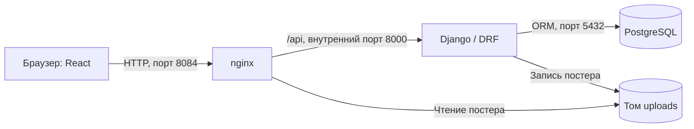

# Сценарий защиты: каталог фильмов, вариант 25

Основной показ занимает примерно 12–15 минут без подробного разбора всех файлов. Сначала показывайте действие, затем объясняйте, какая часть кода за него отвечает. Уточняющие вопросы и код можно разобрать после демонстрации.

Быстрая памятка — [CHEATSHEET.md](CHEATSHEET.md), ответы на вопросы — [QUESTIONS.md](QUESTIONS.md), устройство проекта — [PROJECT.md](PROJECT.md).

## 1. Подготовка перед защитой

На Mac откройте папку проекта и запустите **`Запустить VM.command`**. Дождитесь сообщения «Ubuntu VM готова». Откройте сайт в обычном браузере на ширине окна, удобной для показа.

Подготовьте рядом:

- Браузер: http://localhost:8084.
- SSH-терминал: **`SSH в VM.command`**.
- Редактор с папкой проекта: модели, views, сериализаторы, permissions и Docker Compose.
- Постер для загрузки: **`docs/demo-poster.png`**. Это копия собственной учебной обложки из демонстрационных данных проекта.
- [GitHub](https://github.com/naerlik1/movie-catalog), [backend-образ](https://hub.docker.com/r/naerlik/movie-catalog-backend), [frontend-образ](https://hub.docker.com/r/naerlik/movie-catalog-frontend).

Проверьте вход двух готовых аккаунтов:

| Роль | Email | Пароль |
| --- | --- | --- |
| Администратор | `admin@example.test` | `AdminPractice2026!` |
| Обычный пользователь | `student@example.test` | `Practice2026!` |

Для демонстрации регистрации используйте свободные имя и email, например `defense_01` и `defense01@example.test`, пароль `Defense2026!`. При повторной репетиции меняйте номер: уже зарегистрированный email повторно создать нельзя. Эти значения — пример нового аккаунта, заранее он не создавался.

Для редактирования и удаления создайте отдельный фильм с названием «Фильм для защиты 01». Все действия показа ниже относятся к этому фильму. Существующие записи каталога для этого менять не требуется.

Если преподаватель будет открывать сайт с другого компьютера, подключите оба устройства к одной сети. Текущий сетевой адрес выводится при запуске VM. Доступ с телефона уже подтверждён; проверку именно со второго компьютера пока нужно выполнить.

## 2. Начало выступления — около 30 секунд

Можно начать так, понимая смысл каждого предложения:

> Мой вариант — каталог фильмов. Посетители могут просматривать фильмы и отзывы. Пользователь после входа отмечает просмотренные фильмы, оставляет отзыв с оценкой и сохраняет избранное. Фильмы и постеры добавляет администратор. Сервер написан на Django REST Framework с классовыми представлениями, интерфейс — на React, база — PostgreSQL. Проект развёрнут в трёх Docker-контейнерах внутри Ubuntu Server VM на моём MacBook.

Покажите общую схему:



На Mac настроен проброс порта 8084 в VM. nginx также отдаёт собранные файлы React. Браузер выполняет React и обращается к API; React сам не подключается к PostgreSQL.

## 3. Показ Ubuntu и контейнеров — около минуты

Откройте **`SSH в VM.command`**. Следующие команды выполняются **внутри Ubuntu**, а не в отдельном терминале macOS:

```bash
cat /etc/os-release
uname -m
cd ~/movie-catalog
docker compose ps
curl http://localhost:8084/health
```

Что объяснить:

> Это Ubuntu Server 24.04 на ARM64. Здесь отдельный Docker Engine. Запущены db, app и nginx. Наружу из контейнеров открыт порт nginx 8084, а Django и PostgreSQL работают во внутренней сети. Health проверяет и приложение, и соединение с базой.

В `ps` покажите три контейнера со статусом `healthy` и названия личных образов с тегом `1.0`. Откройте GitHub и два репозитория Docker Hub, если преподаватель просит подтвердить публикацию.

## 4. Гостевой каталог — около минуты

1. Откройте каталог без входа. Если уже вошли, нажмите «Выйти».
2. Напечатайте «Матрица» в поиске и остановитесь: результат обновится без кнопки.
3. Нажмите «Сбросить». Выберите год, сортировку или минимальный рейтинг и нажмите «Найти».
4. Покажите следующую страницу, если фильтры сброшены и фильмов больше 12.
5. Откройте карточку: видны описание, постер, отзывы и средняя оценка; для собственного отзыва предлагается вход.

Короткое объяснение:

> Каталог публичный. Поиск выполняется на сервере, а React запрашивает результат после паузы 300 мс. Остальные фильтры применяются кнопкой «Найти». Серверная пагинация отдаёт по 12 фильмов, а не весь каталог сразу.

Где код: `frontend/src/pages/CatalogPage.jsx`, `backend/movies/filters.py`, `backend/movies/pagination.py`.

## 5. Администратор: новый фильм и постер — около двух минут

1. Войдите как `admin@example.test`.
2. Нажмите **«+ Добавить фильм»**.
3. Нажмите «Сохранить фильм» с пустыми полями: покажите ошибки у названия и года.
4. Заполните название **«Фильм для защиты 01»**, год **2024**, описание **«Запись для демонстрации каталога на защите»**.
5. Выберите **`docs/demo-poster.png`** и сохраните.
6. На карточке нажмите «Редактировать», измените год на **2023**, сохраните и покажите результат.
7. Запомните адрес карточки `/items/ЧИСЛО`: число назначает база, заранее фиксировать его не нужно.
8. Выйдите из аккаунта.

Что сказать:

> Создать фильм может только администратор. При сохранении Django сам записывает текущего пользователя владельцем. Изменение и удаление разрешены администратору, который добавил фильм. Постер загружается отдельным multipart-запросом; в базе хранится его описание, а изображение — в томе uploads.

Где код: `MovieListCreateView`, `MoviePermission`, `PosterUploadView`, `MovieFile`.

## 6. Регистрация — около минуты

1. Откройте «Регистрация».
2. Сначала заполните неверный email, короткий пароль и несовпадающее подтверждение — покажите ошибки.
3. Введите свободные демонстрационные данные из раздела подготовки и зарегистрируйтесь.
4. После перехода на вход войдите этим новым пользователем.

Что сказать:

> Email уникален без учёта регистра. Username — от 3 до 30 символов: латиница, цифры и подчёркивание. Пароль — от 8 до 64 символов, с буквой и цифрой. Сервер проверяет данные повторно. Пароль сохраняется через create_user как хеш и не возвращается в JSON.

Где код: `backend/accounts/serializers.py`, `validators.py`, `models.py`.

## 7. Пользователь: просмотр, отзыв, рейтинг и Excel — около трёх минут

Откройте созданный **«Фильм для защиты 01»**. У нового пользователя нет собственной отметки и отзыва.

1. Покажите, что до просмотра форма отзыва закрыта.
2. Нажмите **«Отметить просмотренным»** или **«Я посмотрел фильм»**. Появится форма.
3. Нажмите публикацию с пустой формой, чтобы показать ошибки; затем поставьте **8** и напишите **«Отзыв для демонстрации на защите»**.
4. Опубликуйте отзыв. У нового фильма с единственным отзывом средний рейтинг станет **8.0**.
5. Измените оценку на **10** и сохраните. Средний рейтинг станет **10.0**.
6. Покажите, что есть форма изменения своего отзыва, а второй отдельный отзыв на тот же фильм не добавляется.
7. Покажите недоступную кнопку снятия просмотра: при наличии своего отзыва сначала требуется удалить отзыв.
8. Нажмите **«♡ В избранное»**, перейдите в «Избранное».
9. Нажмите **«Скачать Excel»**, откройте файл. У нового пользователя в подборке будет только этот фильм. Покажите название, год, рейтинг и даты.
10. Выйдите из аккаунта.

Объяснение:

> Отметка просмотра личная. Правило проверяется на сервере, поэтому одного изменения интерфейса недостаточно, чтобы его обойти. На фильм у пользователя может быть один отзыв. Среднее вычисляет PostgreSQL через ORM Avg при чтении. По уточнению преподавателя обычный пользователь выгружает только своё избранное; сервер тоже ограничивает состав файла.

Где код: `WatchedView`, `ReviewListCreateView`, `ReviewDetailView`, ограничения в `models.py`, `filtered_movies`, `MovieExportView`, `export_movies`.

## 8. Изоляция пользователей — около минуты

1. Войдите готовым обычным аккаунтом `student@example.test`.
2. Откройте «Избранное». Там его личная подборка; новый фильм не появится от добавления другим пользователем.
3. Откройте «Фильм для защиты 01». Чужой отзыв публично виден, но кнопок изменения этого отзыва нет.
4. В каталоге нет добавления фильма и общей выгрузки Excel.

Что сказать:

> Сервер берёт пользователя из проверенного JWT. Избранное фильтруется по этому пользователю, а endpoint отдельного отзыва выбирает только его собственные отзывы. Чужой отзыв через этот endpoint вернёт 404. Нельзя получить права администратора, передав в запросе role или чужой owner_id.

После этого выйдите.

## 9. Администратор: экспорт и удаление — около минуты

1. Войдите администратором.
2. В каталоге введите полное название демонстрационного фильма. После применения поиска скачайте Excel: фильтр должен ограничить выгрузку одним фильмом.
3. Откройте карточку демонстрационного фильма, нажмите «Удалить фильм», сначала отмените. Запись останется.
4. Снова откройте подтверждение и удалите **только созданный для показа фильм**.
5. Проверьте, что он исчез из каталога. Его отзыв, избранное, отметка просмотра и постер удаляются вместе с ним.

Что сказать:

> Удаление зависимых записей выполняет Django через связи с on_delete=CASCADE. У MovieFile есть обработчик post_delete: физический файл удаляется после успешного завершения транзакции. Отмена в диалоге вообще не отправляет DELETE.

Где код: `models.py`, `signals.py`, `MovieDetailPage.jsx`.

## 10. Код: что открыть в первую очередь — около двух минут

| Файл | Что показать и объяснить |
| --- | --- |
| `backend/movies/models.py` | Поля и связи Movie, MovieFile, Review, Favorite, Watched; ограничения уникальности |
| `backend/movies/views.py` | `MovieListCreateView`: сериализатор, permissions, выборка, автоматическое назначение владельца |
| `backend/movies/serializers.py` | Поля JSON, проверка данных, read_only для полей владельца и дат |
| `backend/movies/permissions.py` | Публичное чтение, администратор для записи, владелец конкретного фильма |
| `frontend/src/pages/CatalogPage.jsx` | Поиск: useEffect → setTimeout 300 мс → параметры URL → запрос API |
| `docker-compose.yml` | Три сервиса, depends_on/healthcheck, тома, единственный опубликованный порт |

Расскажите один полный путь: **«Нажал добавить фильм → React сделал POST /api/movies → nginx передал запрос Django → JWT определил пользователя → permission проверил администратора → serializer проверил поля → ORM сохранила Movie в PostgreSQL → React получил JSON и открыл карточку»**.

По запросу преподавателя откройте `export.py`, `uploads.py`, файлы авторизации и тесты. Пояснение основных классов и функций — в `PROJECT.md`, короткие ответы — в `QUESTIONS.md`.

## 11. Сохранность и тесты — если преподаватель просит

В SSH-терминале Ubuntu:

```bash
cd ~/movie-catalog
docker compose exec app python manage.py test --noinput
```

Ожидается **22 теста и OK**. Они используют отдельную test-БД PostgreSQL и временные файлы.

Для проверки перезагрузки сначала выберите существующий фильм и запомните его отзыв или постер. Затем в Ubuntu:

```bash
cat /proc/sys/kernel/random/boot_id
sudo reboot
```

SSH закроется. После загрузки снова откройте **`SSH в VM.command`**, выполните:

```bash
cat /proc/sys/kernel/random/boot_id
cd ~/movie-catalog
docker compose ps
curl http://localhost:8084/health
```

Boot ID должен измениться, три контейнера — вернуться в healthy. Обновите страницу с выбранным фильмом: данные и постер должны сохраниться. При подготовке после исправления проброса сайт автоматически восстановился примерно за 9 секунд; на защите дождитесь готовности, время может отличаться.

Объяснение:

> Данные PostgreSQL и загруженные изображения находятся в именованных томах, а Docker и SSH включены в автозапуск Ubuntu. У контейнеров restart: unless-stopped. Поэтому обычная перезагрузка сервера сохраняет данные и возвращает приложение в работу.

`docker compose restart` перезапускает контейнеры; `sudo reboot` перезагружает всю Ubuntu VM. `docker compose down -v` удаляет тома с данными — для этой проверки такая команда не нужна.

## 12. Если что-то пошло не так

| Ситуация | Действие |
| --- | --- |
| Сайт после включения Mac не открывается | Запустить `Запустить VM.command`, дождаться готовности |
| На странице осталась ошибка после перезапуска VM | Нажать «Повторить» или обновить страницу |
| Разлогинило после закрытия вкладки | Войти снова: JWT хранится в sessionStorage вкладки |
| Фильм не находится | «Сбросить» фильтры; проверить, что открыт общий каталог, а не избранное |
| Email уже занят на репетиции | Использовать следующий номер в демонстрационном email и username |
| Не получается снять просмотр | Удалить свой демонстрационный отзыв, затем снять отметку |
| Нет кнопки добавления фильма | Проверить, что вошли администратором |
| С другого устройства не открывается | Проверить одну Wi-Fi сеть и адрес из запуска VM; после смены сети повторить запуск |

Текущие результаты установки и проверок зафиксированы в [VERIFICATION.md](VERIFICATION.md). Сценарий выше — план для вашей репетиции; сам по себе он не означает, что новые регистрация, фильм и удаление уже выполнены.
